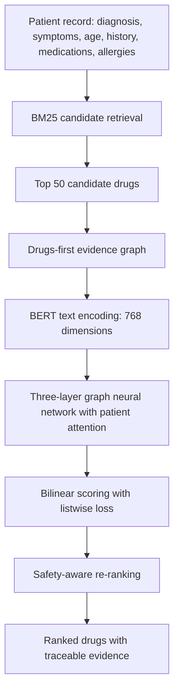

# IntelliRx

**Robust Medication Recommendation System with Advanced Representation Learning**

Senior Design Project · Fall 2026/2027 · College of Computing and Informatics, University of Sharjah

**Team:** Sara Al Zaben · Maryam Ali · Amna Almazrouei  
**Supervisor:** Dr. Ayad Turky

> **Research prototype only.** IntelliRx supports clinical research and clinician review. It does not prescribe medication and does not replace professional judgment. All experiments use synthetic data.

This repository contains the code, scripts and result tables of the IntelliRx senior design project. It accompanies the project report and allows every reported result to be re-created.

---

## 1. Introduction

Prescribing a medicine is rarely a single-factor decision. The diagnosis has to be weighed against the patient's age, population group, current medicines and allergies, and a choice that suits one patient can be harmful for another. IntelliRx is a drug recommendation system that ranks candidate medicines for a patient and shows the medical evidence behind each suggestion.

IntelliRx is built on **TraceDR** [1], a graph-based model that retrieves candidate drugs from a medical knowledge graph, builds an evidence graph, and uses a graph neural network (GNN) with patient attention to predict both the recommended drugs and the evidence that supports them. We reproduced TraceDR on a single laptop GPU (8 GB), corrected problems in its released code, and extended it with three improvements that target accuracy and safety. Every change was tested against the original model on the same patients with paired statistical tests.

## 2. Problem statement

For each patient the system receives up to 50 candidate drugs and must rank them so that a correct drug comes first, while keeping drugs that conflict with the patient's current medicines, allergies or population group away from the top of the list. We found three weaknesses in TraceDR:

1. **Graph construction.** The patient graph is filled one drug at a time and is limited to 100 nodes, so only a few drugs receive a node. The remaining candidates can never be recommended, even when they are correct.
2. **Training loss.** Every node is scored separately with binary cross-entropy, but most nodes can never be the answer. The model is rewarded for rejecting easy nodes instead of putting the right drug first.
3. **Safety.** Interaction, caution and allergy facts are measured in the evaluation but are not used when the drugs are ranked.

## 3. Contributions

1. **A corrected and documented reproduction of TraceDR** on modest hardware. We fixed six problems in the released code, the most serious being a scoring error that counted padding positions as ranks and hid about 37 points of P@1.
2. **Three targeted improvements**, each an option that is off by default:

| TraceDR weakness | IntelliRx improvement | Option |
|---|---|---|
| Graph omits many candidate drugs | **Drugs-first graph:** all 50 candidates are added before their evidence | `--drugs_first` |
| Loss does not match the ranking task | **Listwise loss:** only drugs compete with each other | `--answer_loss listwise` |
| Safety is not used when ranking | **Safety-aware re-ranking:** drugs that interact with current medicines, carry a caution for the patient's group, or contain an allergen move below every safe drug | `--safety_rerank 100` |

   A safety penalty during training (`--safety_weight 1.0`) was also tested and had no effect.

3. **A careful evaluation protocol:** all models are scored on the same patients, every comparison is paired, and we report permutation tests, bootstrap confidence intervals and the numbers of patients fixed and broken, together with an ablation of each change.
4. **An exploratory analysis** of an 800-patient subset of DrugRec.

## 4. System architecture



The safety step checks three rules: interaction with a drug the patient already takes, a caution for the patient's population group, and an ingredient the patient is allergic to. These checks depend on the completeness of the knowledge graph and are not a comprehensive clinical safety screening.

## 5. Dataset

The experiments use **DrugRec**, the synthetic benchmark released with TraceDR [1], which contains Chinese-language patient records (21,000 patients; 12,600 / 4,200 / 4,200 train / dev / test split). Models were trained on at most 800 training patients and scored on 300 or 1,000 test patients. The exploratory analysis in the report uses an 800-patient subset (480 training, 160 validation, 160 test).

The dataset is **not included** in this repository. Download it from the TraceDR repository (<https://github.com/zhenjia2017/TraceDR>) and place the prepared files under `intermediate_data/DrugRec0716/`. The prepared files already contain the 50 BM25 candidates of every patient, so the retrieval step is not re-run.

## 6. Results

All models were scored on the same **1,000 held-out test patients**. Higher is better for P@1, MRR, Hit@5, F1@5 and Jaccard; lower is better for DDI, Group and CMS. CMS is the share of patients with an unsafe drug in the top five.

| Model | P@1 | MRR | Hit@5 | F1@5 | Jaccard | DDI | Group | CMS |
|---|---|---|---|---|---|---|---|---|
| TraceDR (baseline) | 0.391 | 0.508 | 0.666 | 0.240 | 0.166 | 0.039 | 0.020 | 0.059 |
| + listwise loss | 0.430 | 0.543 | 0.701 | 0.253 | 0.175 | 0.039 | 0.020 | 0.059 |
| + drugs-first graph | 0.465 | 0.584 | 0.740 | 0.272 | 0.189 | 0.038 | 0.020 | 0.058 |
| Improved (listwise + drugs-first) | 0.487 | 0.600 | 0.750 | 0.274 | 0.190 | 0.043 | 0.019 | 0.062 |
| **IntelliRx** (improved + re-ranking, β = 100) | **0.541** | **0.640** | **0.769** | **0.285** | **0.199** | **0.003** | **0.003** | **0.006** |

**Summary:** precision at rank 1 (P@1) rises from 0.391 to 0.541, and the share of unsafe drugs in the top five falls from 5.9% to 0.6%. All differences to the baseline in accuracy and safety are significant (paired permutation test, p < 0.05). Most of the accuracy gain comes from the drugs-first graph, and the safety gain comes from re-ranking.

## 7. Repository layout

The repository root corresponds to the `TraceDR-model` folder of the project. Each experiment folder holds its own variant of the code, so every result stays next to the exact code that produced it.

```
.
├── train_TraceDR.py, model.py, data_process.py, metrics.py, bm25_es.py
├── make_subset.py          builds the training subsets and test sets
├── collect_results.py      collects results into a table
├── run_curve.bat           baseline at 200 / 400 / 800 training patients
├── run_test1000.bat        re-scores the models on 1,000 test patients
├── baseline_results.csv, paired_test_results.csv
├── improved_model/         listwise loss + drugs-first graph
├── ablation/               each improvement alone
└── safety/                 safety penalty and safety re-ranking
```

Trained model checkpoints and run logs are not included because of their size; the scripts below re-create them.

## 8. Reproducing the results

Run the commands in order from an Anaconda Prompt with the environment active (Windows, NVIDIA GPU, PyTorch 2.8.0 with CUDA 12.8). Times are approximate on an RTX 4060 laptop GPU.

```bash
conda activate TraceDR
pip install jieba rank_bm25 transformers tqdm ijson
pip install torch==2.8.0 --index-url https://download.pytorch.org/whl/cu128
```

| Step | Folder | Command | Time |
|---|---|---|---|
| 1. Build training subsets | root | `python make_subset.py --from_intermediate intermediate_data\DrugRec0716 --train_sizes 200,400,800 --n_dev 200 --n_test 300 --out_bench DrugRec_mini` | 3–5 min |
| 2. Baseline at 200/400/800 | root | `run_curve.bat` | ~40 min |
| 3. Improved model | `improved_model` | `run_improved.bat`, then `python compare_results.py` and `python paired_test.py` | ~45 min |
| 4. Ablation at 800 | `ablation` | `run_ablation.bat` | ~60 min |
| 5. 1,000-patient test set | root | `run_test1000.bat` | ~30 min |
| 6. Safety (improvement 3) | `safety` | `run_safety.bat` | ~45 min |
| 7. Extra re-ranking runs | `safety` | `run_rerank_extra.bat` | ~15 min |

Main options of `train_TraceDR.py`:

| Option | Meaning |
|---|---|
| `--benchmark NAME` | dataset folder under `intermediate_data` |
| `--eval` | score a saved model instead of training |
| `--rank_drugs_only` | corrected ranking: only drug nodes are recommended (used for every model) |
| `--answer_loss listwise` | improvement 1 |
| `--drugs_first` | improvement 2 |
| `--safety_weight 1.0` | improvement 3a (training penalty) |
| `--safety_rerank 100` | improvement 3b (re-ranking at test time) |
| `--epochs 2` | epochs used in all experiments |

All options default to off, so running without them reproduces the original TraceDR. A saved model must be scored with the same `--answer_loss` and `--drugs_first` options it was trained with.

## 9. Limitations

- Each model was trained on at most 800 patients for 2 epochs instead of the default 5, with a single random seed. The significance tests capture the variation between test patients, not between training runs, and the order of the methods could change with full training.
- DrugRec is synthetic, and in it the correct drugs are almost never unsafe for the patient. The same accuracy gain from re-ranking may not hold on real prescriptions.
- The safety metrics check the same three rules that the re-ranking enforces, so a low unsafe rate measures agreement with those rules and not clinical safety in general.
- For about 10% of test patients the correct drug is not among the 50 retrieved candidates, which caps every model.
- Our numbers are not directly comparable with those printed in the TraceDR paper, because the corrected scoring changes them.

## References

[1] Y. Lin, Z. Jia, P. Christmann, X. Zhang, S. Du, and T. Li, "Traceable drug recommendation over medical knowledge graphs," MediKS Workshop at CIKM '25, 2025. arXiv:2510.27274.
